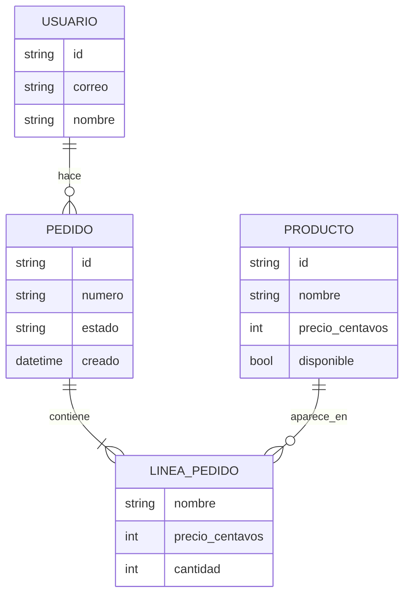

# 05 · Modelo de datos · Cafetería de la UTEZ

> Modelo de datos = qué cosas guarda el sistema y cómo se relacionan (conceptual: sin tipos de columna ni índices), más las reglas que valen para todas.

## Tabla de decisiones

| # | Decisión | Alternativa descartada | Por qué | Fecha |
|---|---|---|---|---|
| M-01 | El precio se guarda en centavos enteros | Número decimal | Evita errores de redondeo al sumar el total del pedido | 2026-10-22 |
| M-02 | La línea de pedido copia el nombre y el precio del producto al momento de pedir | Apuntar solo al producto | Si la cafetería cambia un precio mañana, el pedido de hoy no cambia de total | 2026-10-22 |
| M-03 | El estado del pedido es uno de `recibido`, `en_preparacion`, `listo` o `entregado` | Un booleano «listo» | H-03 del PRD distingue en preparación de listo, y la cocina necesita saber cuáles ya se entregaron | 2026-10-22 |
| M-04 | Un producto no se borra: se marca `disponible: false` | Borrarlo | Los pedidos viejos lo siguen mostrando y H-01 pide verlo agotado en gris | 2026-10-22 |

## ERD conceptual

Entidades con sus atributos clave y relaciones con cardinalidad.

## Diccionario breve

| Entidad | Qué representa | Quién la crea | Quién la lee |
|---|---|---|---|
| USUARIO | Persona registrada con Firebase Auth | La app, al registrarse | La app y la cocina (solo el nombre) |
| PRODUCTO | Algo que la cafetería vende | La cocina o el administrador, desde la consola de Firebase | La app |
| PEDIDO | Una compra pendiente o entregada, con su número de 3 dígitos | La app, al confirmar | La persona que lo hizo y la cocina |
| LINEA_PEDIDO | Un producto y su cantidad dentro de un pedido | La app, al confirmar | La persona que lo hizo y la cocina |

## Reglas transversales

- Identificadores: texto generado por Firestore; el número de 3 dígitos del pedido es para mostrar, no es el identificador.
- Fechas: UTC en formato ISO 8601; la app las muestra en hora de Morelos.
- Borrado: no se borra de verdad, se marca como inactivo o `disponible: false` (M-04).
- Datos personales: solo `correo` y `nombre` (PRD, requisito de privacidad); ninguno se copia al pedido, que guarda solo el `id` del usuario.
- Dinero: siempre en centavos enteros y pesos mexicanos (M-01).
